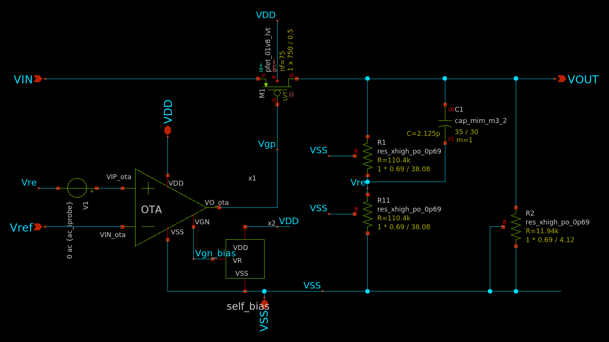

<!--
================================================================================
Archivo: README.md
Descripción:
    Documento principal del repositorio LDO-sky130 (en inglés). Resume de forma
    sencilla la arquitectura y el esquemático del regulador LDO diseñado en
    SkyWater 130 nm (sky130A), sus especificaciones en caso típico (tt, 1.8 V,
    27 °C) y la tabla de pines (Pinout).
================================================================================
-->

# LDO Voltage Regulator in SkyWater 130 nm (`sky130A`)

Design, simulation (Schematic, PVT, Monte Carlo, and Post-Layout PEX), and physical layout of a Low-Dropout (**LDO**) linear voltage regulator developed using open-source EDA tools (**Xschem**, **Ngspice**, **KLayout**, **Magic**, and **Netgen**) for **Silicluster v3 (OnChip-UIS)**.

---

## 1. Architecture

The regulator operates across an input voltage range **$V_{\text{IN}}$ from $1.3\text{ V}$ to $1.8\text{ V}$**, delivering a regulated output voltage of **$1.2\text{ V}$** (from a reference voltage $V_{\text{ref}} = 0.6\text{ V}$) for load currents up to **$5\text{ mA}$**. It consists of three main building blocks:

- **Current Reference (`self_bias`):** Self-biased current and voltage reference with a start-up circuit that generates the bias voltage `Vgn_bias`.
- **Error Amplifier (`OTA`):** Two-stage differential operational transconductance amplifier with Miller compensation ($R_z + C_{\text{Miller}}$).
- **Power Stage & Feedback Network (`LDO`):** PMOS LVT pass transistor (`M1`), resistive feedback divider ($R_1, R_{11}$), bleeder resistor ($R_2$), and feedforward capacitor ($C_1$).

---

## 2. Typical Specifications (`tt`, $V_{DD} = 1.8\text{ V}$, $27\ ^\circ\text{C}$)

| Parameter | Typical Value (Schematic) | Typical Value (Post-Layout PEX) |
| :--- | :---: | :---: |
| **Input Voltage Range ($V_{\text{IN}}$)** | $1.3\text{ V} \text{ – } 1.8\text{ V}$ | $1.3\text{ V} \text{ – } 1.8\text{ V}$ |
| **Reference Voltage ($V_{\text{ref}}$)** | $0.6\text{ V}$ | $0.6\text{ V}$ |
| **Output Voltage ($V_{\text{OUT}}$)** | $1.198\text{ V}$ | $1.198\text{ V}$ |
| **Maximum Load Current ($I_{\text{load,max}}$)** | $5\text{ mA}$ | $5\text{ mA}$ |
| **DC Loop Gain ($A_{v0}$)** | $67.10\text{ dB}$ | $67.10\text{ dB}$ |
| **Unity-Gain Bandwidth ($\text{UGB}$)** | $299.88\text{ kHz}$ | $299.88\text{ kHz}$ |
| **Phase Margin ($\text{PM}$)** | $96.36^\circ$ | $96.36^\circ$ |
| **PSRR ($1\text{ kHz} \text{ / } 10\text{ kHz} \text{ / } 1\text{ MHz}$)** | $71.49\text{ dB} \text{ / } 62.84\text{ dB} \text{ / } 45.86\text{ dB}$ | $73.38\text{ dB} \text{ / } 62.29\text{ dB} \text{ / } 43.88\text{ dB}$ |
| **Line Regulation** | $0.419\text{ mV}$ | $0.441\text{ mV}$ |
| **Load Regulation ($1\ \mu\text{A} \rightarrow 5\text{ mA}$)** | $0.720\text{ mV}$ | $0.725\text{ mV}$ |
| **Dropout Voltage ($V_{\text{DO}}$ at $5\text{ mA}$)** | $53.69\text{ mV}$ | $56.08\text{ mV}$ |
| **Undershoot / Overshoot ($1\ \mu\text{A} \leftrightarrow 5\text{ mA}$)** | $3.49\text{ mV} \text{ / } 2.49\text{ mV}$ | $3.04\text{ mV} \text{ / } 2.12\text{ mV}$ |

---

## 3. Pinout Table

- **Layout Dimensions:** $152.43\ \mu\text{m} \times 82.91\ \mu\text{m}$
- **DRC & LVS Status:** `0` DRC errors (KLayout and Magic) and LVS clean (`Netlists match`).

| Pin | Direction | Layout Layer | Requested Pins / Pads | Description |
| :--- | :---: | :---: | :---: | :--- |
| **`VDD`** | `inout` | `met4` (V) / `met5` (H) | `VDD` Power Grid | Main power supply ($1.8\text{ V}$). |
| **`VSS`** | `inout` | `met4` (V) / `met5` (H) | `VSS` Power Grid | Analog ground and substrate ($0\text{ V}$). |
| **`VIN`** | `input` | `met3` | 1 Analog Pad | Power stage input voltage ($1.3\text{–}1.8\text{ V}$). |
| **`Vref`** | `input` | `met3` | 1 Analog Pad | External reference voltage ($0.6\text{ V}$). |
| **`VOUT`** | `output` | `met3` | **2 Analog Pads** | Regulated output voltage ($1.2\text{ V}$, up to $5\text{ mA}$). |
